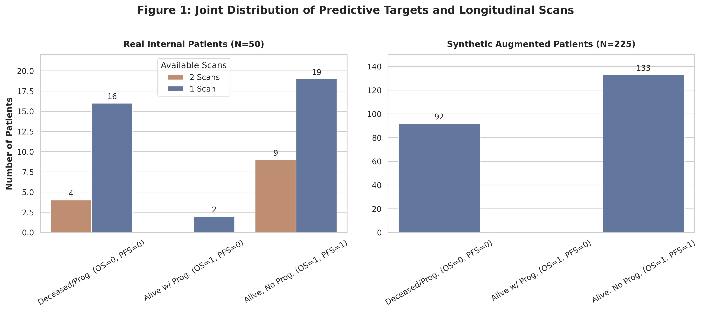
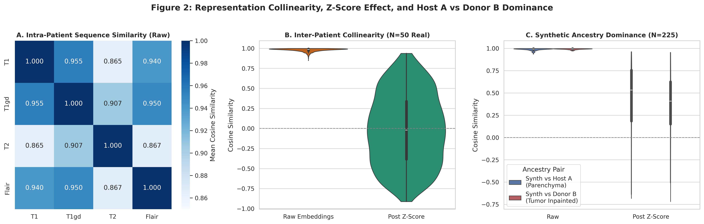
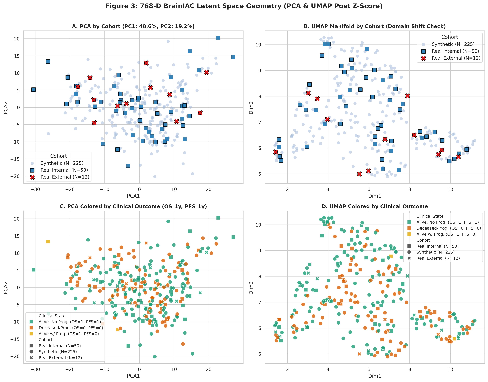

# Analisi esplorativa dei dati e geometria dello spazio latente

**Premessa.** Prima di addestrare qualsiasi modello abbiamo esaminato i dati per capirne struttura, punti di forza e limiti. Ogni risonanza magnetica (MRI) comprende quattro sequenze (**T1, T1gd, T2, Flair**), cioè quattro modalità diverse di osservare lo stesso cervello. Invece di lavorare sui pixel dei volumi 3D, usiamo gli embedding estratti dal modello **BrainIAC**: per ogni sequenza abbiamo un vettore di 768 numeri che riassume l’immagine.

L’obiettivo è prevedere a un anno due esiti clinici:
* **OS_1y** (*Overall Survival*): sopravvivenza globale a un anno.
* **PFS_1y** (*Progression-Free Survival*): sopravvivenza libera da progressione a un anno.

Il dataset include **50 pazienti reali interni** (usati in cross-validation), **225 pazienti sintetici** (ottenuti inserendo il tumore di un *Donor B* nel cervello sano di un *Host A* tramite inpainting) e **12 pazienti esterni** (usati per valutare la generalizzazione).

---

## A. Distribuzione degli esiti e scansioni longitudinali

* **Come abbiamo fatto il grafico:** abbiamo raggruppato i record per **paziente unico** (50 reali interni e 225 sintetici) e conteggiato quanti pazienti ricadono in ciascuna combinazione di `(OS_1y, PFS_1y)`, distinguendo nei reali chi ha 1 o 2 scansioni[cite: 2, 7].
* **Perché lo abbiamo fatto:** per controllare lo sbilanciamento delle classi, verificare l’assenza di casi clinicamente impossibili (`OS=0, PFS=1`) e capire quanto pesano i pazienti con due scansioni[cite: 2, 7].

**Cosa osserviamo:**
* Nella coorte interna (50 pazienti unici), **20 pazienti (40%)** sono in stato `(0,0)` (deceduti o progrediti), **28 (56%)** sono in stato `(1,1)` (vivi senza progressione) e solo **2 (4%)** sono in stato `(1,0)` (vivi con progressione). Complessivamente la sopravvivenza a un anno è del **60%** (30/50) e la sopravvivenza libera da progressione è del **56%** (28/50). Il caso intermedio `(1,0)` è troppo raro per essere appreso in modo stabile.
* **13 pazienti** hanno due scansioni longitudinali, e **9 di essi** appartengono alla classe favorevole `(1,1)`. Contare le singole righe invece dei pazienti gonfierebbe la classe positiva e rischierebbe di far finire una scansione nel training e l’altra nel test: per questo lavoriamo sempre a livello di paziente.
* I **225 pazienti sintetici** presentano **92 casi `(0,0)` (40,9%)** e **133 casi `(1,1)` (59,1%)**, con proporzioni vicine a quelle reali, ma **zero casi `(1,0)`** perché la generazione ha accoppiato solo pazienti con esiti concordanti[cite: 2, 7].

---

## B. Collinearità degli embedding e dominanza dell’Host

* **Come abbiamo fatto il grafico:** abbiamo calcolato la **similarità coseno** (dove `1` indica vettori molto allineati e `0` assenza di allineamento lineare) in tre modi:
  1. tra le 4 sequenze MRI all’interno dello stesso esame (*Pannello A*);
  2. tra coppie di pazienti reali diversi, confrontando i vettori grezzi con quelli standardizzati tramite **z-score** per sequenza (*Pannello B*);
  3. tra ciascun paziente sintetico e il suo **Host A** (parenchima) oppure il suo **Donor B** (tumore), prima e dopo lo z-score (*Pannello C*).
* **Perché lo abbiamo fatto:** per verificare se i vettori BrainIAC sono dominati da un’anatomia comune, controllare se lo z-score ripulisce questo effetto e capire se il vettore sintetico somiglia di più al cervello sano dell’Host o alla lesione del Donor.

**Cosa osserviamo:**
* **Sequenze MRI:** `T1`, `T1gd` e `Flair` hanno similarità elevata (`0,940–0,955`), mentre `T2` è leggermente più distinta (`0,865–0,907`). Standardizzare ogni sequenza separatamente evita che una modalità schiacci le altre.
* **Effetto z-score:** sugli embedding grezzi, pazienti diversi mostrano similarità molto alta (`≈ 0,98`) perché BrainIAC riassume l’intero volume cerebrale e ne cattura soprattutto la forma generale. Lo z-score per sequenza rimuove questa componente media comune e porta la similarità inter-paziente attorno a `0`, facendo emergere le differenze tra individui.
* **Dominanza dell’Host A:** dopo lo z-score, i pazienti sintetici risultano più vicini all’**Host A** (mediana `> 0,50`) che al **Donor B** (mediana `≈ 0,40`). È coerente con il fatto che BrainIAC codifica l’intero volume (`96×96×96`) e che il parenchima dell’Host è conservato con altissima fedeltà (`MS-SSIM 0,995`). Poiché i sintetici condividono genitori con altri campioni, **né Host A né Donor B devono mai comparire nel fold di validazione** quando il sintetico è nel training.

---

## C. Topologia dello spazio latente e domain shift

* **Come abbiamo fatto il grafico:** dopo lo z-score (calcolato solo sui reali interni) e la media per paziente, abbiamo ridotto i 768 embedding a 2 dimensioni tramite **PCA** (fittata sui reali interni e proiettata su tutti) e **UMAP**, colorando i punti sia per **coorte** (interni, sintetici, esterni) sia per **esito clinico**.
* **Perché lo abbiamo fatto:** per capire quanto è “concentrata” l’informazione nello spazio a 768 dimensioni, verificare se i 12 pazienti esterni mostrano un forte **domain shift** e vedere se le classi `(0,0)` e `(1,1)` sono già separate lungo le direzioni di massima varianza.

**Cosa osserviamo:**
* **Compattezza dello spazio:** le prime due componenti principali spiegano il **67,8% della varianza totale** (`PC1: 48,6%`, `PC2: 19,2%`) partendo da 768 dimensioni. L’informazione principale si concentra in un sottospazio compatto, adatto a modelli lineari regolarizzati e a reti neurali con un collo di bottiglia stretto, ideali quando i pazienti reali sono pochi.
* **Coorte esterna:** i **12 pazienti esterni** (croci rosse) ricadono all’interno della nuvola dei pazienti interni e sintetici sia in PCA sia in UMAP, senza un distacco netto che indichi un forte domain shift. Essendo solo 12, resta comunque un segnale incoraggiante e non una prova definitiva di generalizzazione.
* **Separabilità degli esiti:** PCA e UMAP non separano nettamente `(0,0)` e `(1,1)`. Le variazioni più ampie riflettono soprattutto la morfologia cerebrale globale, mentre il segnale prognostico legato al tumore è più fine: per coglierlo servono modelli supervisionati che pesino in modo mirato le feature rilevanti.